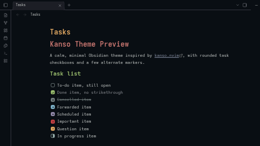

# Kanso for Obsidian

A calm, minimal Obsidian theme ported from [kanso.nvim](https://github.com/webhooked/kanso.nvim), with five variants: Zen, Ink, Mist, Void, and Pearl.

## Features

- Five variants: Zen, Ink, Mist, and Pearl match kanso.nvim's palettes; Void is a true-black variant built on the same hues, for OLED screens
- Code blocks colored like kanso.nvim
- Things-inspired task checkboxes, with eight styled markers and a choice of square, rounded, or circle
- Styling for the [Tasks](https://github.com/obsidian-tasks-group/obsidian-tasks) plugin's due, scheduled, and start dates
- Focus mode, which hides the title bar, status bar, and ribbon for distraction-free writing
- Optional settings through [Style Settings](https://github.com/mgmeyers/obsidian-style-settings)

## Installation

**From Obsidian (recommended):** open **Settings → Appearance → Themes → Manage**, search for **Kanso**, then select **Install and use**.

**Manually:** download `manifest.json` and `theme.css` from the [latest release](https://github.com/friesentius/obsidian-kanso/releases/latest), and put both in `<your-vault>/.obsidian/themes/Kanso/`. Then select **Kanso** under **Settings → Appearance → Themes**.

## Settings

Kanso works without any plugins. With the Style Settings plugin installed, the **Kanso** section adds:

| Setting | Options | Default |
| --- | --- | --- |
| Variant | Zen, Ink, Mist, Void, Pearl | Without the plugin: Zen in dark mode, Pearl in light mode |
| Checkbox shape | Square, Rounded, Circle | Rounded |
| Readable line width | Width in pixels | 760px |
| Radius | Size in pixels | 8px |
| Editor font size | Size in pixels | 16px |
| Focus mode | On, Off | Off |

Choosing a variant sets the color scheme: Pearl is always light, and Zen, Ink, Mist, and Void are always dark. Void swaps the editor and sidebar backgrounds for a true black, for OLED screens, while keeping the same hue relationships as the other dark variants.

## Task checkboxes

| Marker | Meaning | Style |
| --- | --- | --- |
| `[ ]` | To do | Outlined |
| `[x]` | Done | Green, muted text |
| `[-]` | Cancelled | Grey with an X, struck-through text |
| `[>]` | Forwarded | Blue, right arrow |
| `[<]` | Scheduled | Violet, left arrow |
| `[!]` | Important | Red, exclamation mark |
| `[?]` | Question | Yellow, question mark |
| `[/]` | In progress | Half-filled aqua |

## Tasks plugin

If the Tasks plugin is installed, Kanso colors its dates. Due dates are red when overdue and orange when due today. Scheduled and start dates are orange once they have passed. Created, done, and cancelled dates are muted. You don't need any extra markup.

## Focus mode

With the Style Settings plugin installed, turning on Focus mode hides the title bar, status bar, and ribbon for distraction-free writing. Hover near the left edge to bring the ribbon back, the bottom-right to bring the status bar back, or the window controls in the top-right to bring the title bar back; move the pointer away and each hides again. On touch devices, where there's no hover to rely on, the ribbon stays visible so Settings is always reachable. Turn the setting off to restore the normal layout.

## Compatibility

Requires Obsidian 1.5.8 or later, on desktop and mobile.

## Credits

- Colors from [kanso.nvim](https://github.com/webhooked/kanso.nvim) by webhooked.
- The idea of styling alternate checkbox markers comes from [obsidian-things](https://github.com/colineckert/obsidian-things) (MIT), which credits kepano's [Minimal theme](https://minimal.guide/Block+types/Checklists#Checkbox+styling). Kanso's own selectors, icons, and colors are an independent implementation.
- The idea of a focus mode that hides the title bar, status bar, and ribbon comes from kepano's [Minimal theme](https://github.com/kepano/obsidian-minimal) (MIT). Kanso's CSS is an independent implementation.

## Feedback

Found a bug or have an idea? [Open an issue](https://github.com/friesentius/obsidian-kanso/issues).

## License

[MIT](LICENSE)
