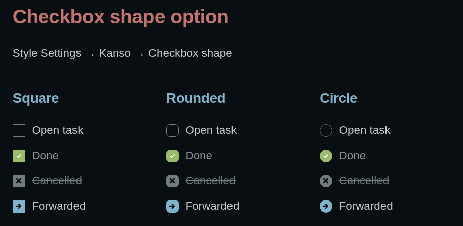

# Kanso for Obsidian

An Obsidian app theme based on [`webhooked/kanso.nvim`](https://github.com/webhooked/kanso.nvim), with variants for Zen, Ink, Mist, and Pearl.

## Install

Copy this folder into:

```text
<your-vault>/.obsidian/themes/Kanso
```

Then open **Settings → Appearance → Themes** and select **Kanso**.

## Variants

Install the [Style Settings](https://github.com/mgmeyers/obsidian-style-settings) plugin and pick a variant from the **Kanso** section:

- Kanso Zen
- Kanso Ink
- Kanso Mist
- Kanso Pearl

The selected variant overrides Obsidian's base color scheme:

- Kanso Pearl always uses the light palette.
- Kanso Zen, Kanso Ink, and Kanso Mist always use dark palettes.

Style Settings also provides Kanso layout controls (readable width, radius, editor font size) and a **Checkbox shape** option (Square, Rounded, Circle). Without the Style Settings plugin installed, checkboxes default to Rounded.



## Task checkboxes

Checkbox shape is Rounded by default (Square and Circle are also available, see above), and a handful of alternate checkbox markers get their own color and glyph in Kanso's own palette. Every glyph is drawn at the same bold stroke weight as Obsidian's own checkmark, so the set reads as one family instead of thin font characters:

| Marker | Meaning | Style |
| --- | --- | --- |
| `[ ]` | To-do | Outlined |
| `[x]` | Done | Filled green, muted text (no strikethrough) |
| `[-]` | Cancelled | Filled muted, bold X cut out, strikethrough text |
| `[>]` | Forwarded | Filled blue, bold arrow |
| `[<]` | Scheduled | Filled violet, bold arrow |
| `[!]` | Important | Filled red, bold exclamation mark |
| `[?]` | Question | Filled yellow, bold question mark |
| `[/]` | In progress | Half-filled aqua |

The idea of styling alternate checkbox markers was inspired by [colineckert/obsidian-things](https://github.com/colineckert/obsidian-things) (MIT licensed), which documents the technique as originating from kepano's [Minimal theme](https://minimal.guide/Block+types/Checklists#Checkbox+styling). Kanso's selectors, icons, and colors are an independent implementation in Kanso's own palette.

## Tasks plugin

Kanso styles the metadata the [Tasks](https://github.com/obsidian-tasks-group/obsidian-tasks) community plugin adds to rendered tasks in Reading view and query results, using its documented [styling classes and data attributes](https://publish.obsidian.md/tasks/Advanced/Styling):

- **Due date** (`task-due`): red and bold when overdue, orange and bold when due today, muted otherwise.
- **Scheduled / start** dates: orange when in the past, muted otherwise.
- **Created / done / cancelled** dates: muted, so they recede behind the task text.

No Tasks-specific markup is required; these rules key off the plugin's own classes and only apply when the plugin is installed and enabled.

## License

[MIT](LICENSE)
